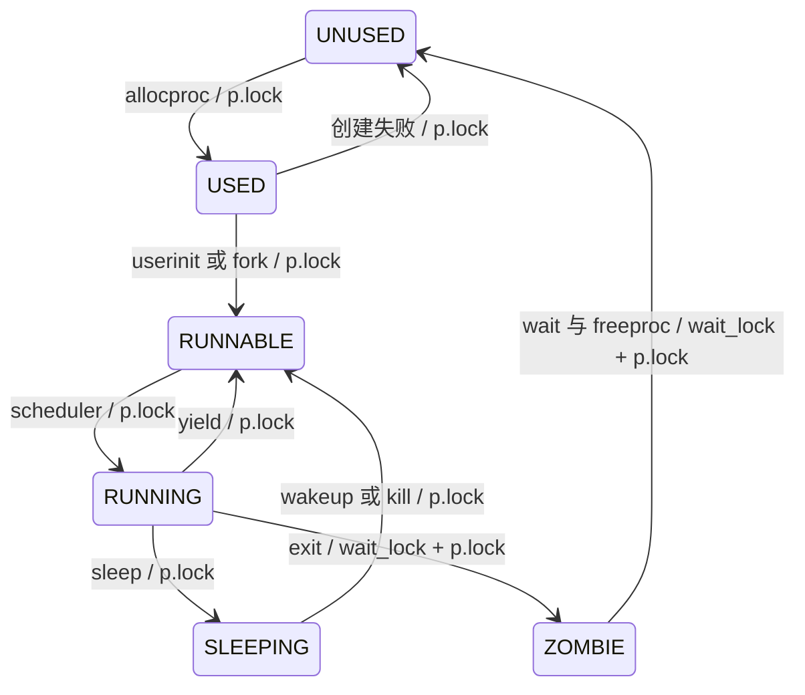
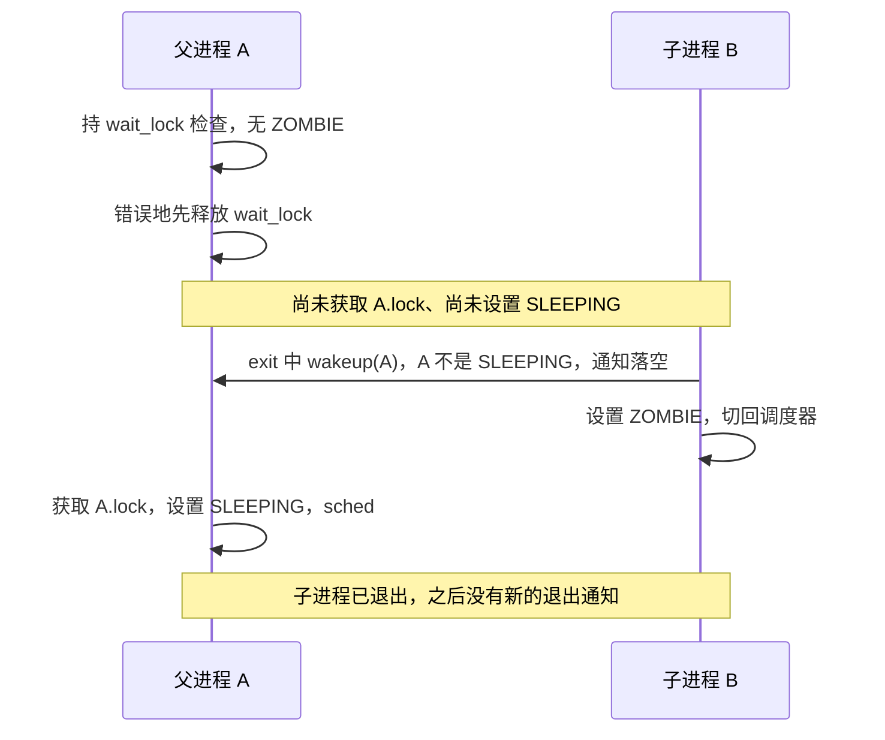

# lab4 设计笔记

学号：2024302111357。实验说明书 V3，配套 lab4-v2-20261009。

## 起点与范围

`LAB4_POLICY_ID=7` 对应按名称分配票数的步长调度，按新版策略表解释，不使用 course_sid.h 中早期占位注释。hi=1、spin=2、sh=4；其他名称默认 1 票。显式 setickets 覆盖默认票数，并在 fork、exec 后保留该设定。首次创建进程的计数归零；fork 复制票数与显式设置标志，不继承 CPU 使用量。

本实验以 `-smp 1` 验收，副核仍停驻。使用每 CPU 的数据结构为后续扩展留出正确接口，但不宣称已支持双核。先以轮转完成机制和 bench，再启用步长策略。

| 项目 | lab3-submit 实际情况 | lab4 改造 |
| --- | --- | --- |
| 进程表锁 | 没有锁，以单核关中断保护 | 每进程 p->lock；parent 关系由 wait_lock 保护 |
| CPU 上下文 | 静态 scheduler_context、全局 current_proc | cpus[NCPU]，context/proc/noff/intena |
| 自旋锁 | 尚未实现 | acquire/release、push_off/pop_off、持锁 CPU 检查 |
| 让出时机 | wait/read 主动休眠，用户时钟已有抢占 | 保留用户抢占，增加 pause；不在内核时钟中切换 |
| 调度顺序 | 进程表固定扫描 | 轮转游标，再选择最小 pass；同 pass 轮转 |
| sleep/wakeup | 关中断下设置状态，无条件锁参数 | sleep(chan, lk) 与条件锁、进程锁交接 |
| 内存与用户指针 | SV39、独立页表、copyin/out/instr | 保持隔离与失败回滚；新系统调用同样验证用户指针 |

## swtch 与栈

预置 swtch 的 a0 指向旧 context，a1 指向新 context。ra、sp、s0–s11 共 14 个寄存器按 8 字节排列，末项偏移 104。C 调用点依 ABI 已负责保存跨调用仍存活的 caller-saved 值；swtch 恢复 ra 后 ret，相当于从另一个执行流的 swtch 调用返回，所以无需独立保存 PC。trapframe 则是异步特权级切换的完整用户现场，二者用途不同。

也可以扩大 context 保存全部通用寄存器，但会增加内存读写和上下文大小，并重复调用者已经完成的保存工作。当前 context 为 112 字节；编译期检查结构大小以及 s11 的 104 字节偏移，防止与预置汇编不一致。

allocproc 设置 context.sp 为该进程内核栈顶，context.ra 指向 forkret。新进程的 forkret 首先释放调度器交接的 p->lock，再通过 trampoline 返回用户态。已经运行过的进程从 sched 返回，由其调用方释放 p->lock。

栈序列：A 用户栈 → uservec 读取 A trapframe 的 kernel_sp → A 内核栈 → swtch → CPU 调度器栈 → swtch → B 内核栈 → userret/sret → B 用户栈。调度器沿用独立引导栈，不依附会退出的进程栈。

## 状态迁移与锁

sched 的四项断言是持有 p->lock、noff==1、状态不是 RUNNING、中断关闭；intena 跨 swtch 保存恢复。p->lock 跨越状态更改与栈切换，防止进程尚未离开栈时被另一个调度流再次选中。

sleep 先持条件锁检查条件，随后 acquire(p->lock)、release(lk)、记录 chan/SLEEPING、sched。醒来先清 chan、释放 p->lock，再重新 acquire(lk)。锁顺序始终为条件锁（console、ticks 或 wait_lock）→ p->lock。wait_lock 保护父子关系，exit 在持 wait_lock 时唤醒父进程并将自己置为 ZOMBIE，然后只保留自己的 p->lock 调用 sched。wakeup 跳过当前进程。

exit 可以先唤醒父进程再设置 ZOMBIE，原因是这两个动作都在 wait_lock 临界区内；父进程醒来仍须取得 wait_lock，才能重新扫描子进程。wait_lock 释放时 ZOMBIE 已可见。避免在持子进程锁时遍历并获取其他进程锁，可以保持父子锁序一致。

kill 只设置 killed 并将休眠者置为 RUNNABLE。控制台读取和 pause 的条件循环检查 killed，返回用户态前也检查；资源仍由 wait 在看到 ZOMBIE 后释放。直接在 kill 中释放目标页表或内核栈，会破坏目标尚未退出的执行现场。

丢失唤醒的错误时序：A 检查无资源 → A 释放条件锁 → B 改变条件并 wakeup（A 尚为 RUNNING）→ A 设置 SLEEPING。若 B 的通知只有一次，A 永远睡眠。正确顺序使唤醒方在获得 A 的 p->lock 后必然看见 SLEEPING。实际复现记录在 verification.md，故障注入仅在隔离测试构建中使用。

## tick 与步长

一个 tick 为一次 S 态时钟中断，周期仍为 time CSR 的 100000 个计数。LAB2_TICK=2 表示每次分发最多运行两次用户态时钟中断；cpu_ticks 和 last_slice_ticks 只统计 usertrap 的时钟分支。调度器分发前重置 last_slice_ticks。内核系统调用可响应中断，但不在内核态抢占；持自旋锁时禁止中断。

步长使用定点数 `(1000ULL << 32) / tickets`，避免较大票数截断成零及整数除法比例误差。调度器选择最小 pass 的 RUNNABLE 进程，分发时增加一步；同 pass 从 rr_idx 开始轮转。每次分发收费一个时间片，主动阻塞也收费一次，纯计算进程按票数获得份额。

新进程和被唤醒者从当前虚拟时间下界开始，已有超前的 pass 不倒退，防止长时间睡眠后积累历史欠账而独占 CPU。显式改票更新 stride 并将 pass 调整到当前下界，以便新比例从后续分发起生效。状态、计数、票数与 pass 均属于 struct proc；单核调度选择期间关闭中断，进程字段仍通过 p->lock 读写。

当虚拟时间达到 `1ULL << 60` 时，调度器从各进程的 pass 中减去该下界，低于下界的睡眠进程归零，再将虚拟时间归零。这样保留就绪进程的相对次序，避免长时间运行后溢出。

exec 在新地址空间完整建立后才获取 p->lock，替换页表、trapframe、名称及策略状态，释放锁后销毁旧页表。失败路径只释放尚未安装的新页表；不会留下进程锁，也不会破坏正在运行的地址空间。

## 编码前的测试设计

1. **固定份额**：两个纯计算子进程设置 6、18 票，父进程按窗口读取 schedstat。每个窗口双方都应得到 CPU，累计后者/前者在 2.4–3.6 之间。另运行不修改的官方 stride_test，以学号派生票数验证。
2. **动态改票**：同一对子进程在预定硬件时间将票数从 6:18 改为 18:6；父进程避开切换边界取样，验证优势方向翻转，第二阶段前者/后者在 2.4–3.6 之间。退出后逐个 wait，并比较空闲页数。

机制测试另包含官方 bench、两个子进程交错输出的 alt、pause 计时、schedstat 的无效/跨页地址、kill 唤醒休眠者，以及重复 fork/exit/wait。保留 lab1 Banner、lab2 inject_uart 和 lab3 页表、非法访存、OOM 回滚与内存守恒回归。
